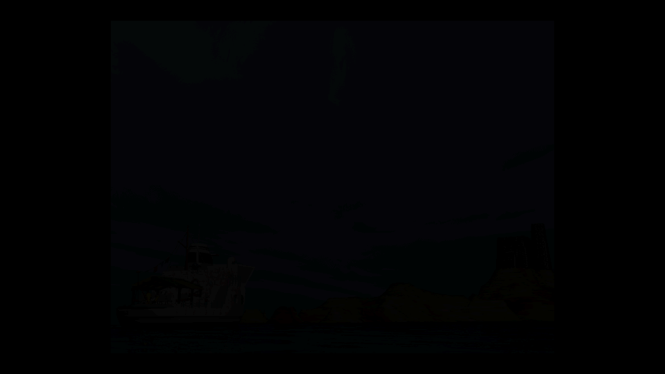

# Little Big Adventure 1

Little Big Adventure, or Relentless: Twinsen's Adventure in North
America, is an action-adventure game developed by Adeline Software
International in 1994.

Didier Chanfray, one of Adeline's founders, acquired the rights to the
game in 2011 through his company. 2.21, the studio he co-founded, have
owned them since 2021. In October of that year, 2.21 released
[the engine's source code](https://github.com/2point21/lba1-classic)
under the GNU General Public License, to preserve a work exceptional
for its time, and to teach from it.

The engine is C and 386 assembly for DOS, built by Watcom C, MASM and
TASM. The release left out AIL/32, John Miles' sound library.

LBA1 Legacy completes that release, builds it for DOS as Adeline built
the CD's `LBA.EXE`, and ports it to Linux and Windows. The aim is the
game as it played in 1994, on today's systems, in code close enough to
Adeline's to study. We changed the release in five steps:

1. We completed it with AIL/32 1.05, which John Miles made freeware in
   2000, and built it for DOS with the compilers and assemblers of
   `LBA.EXE`, Watcom C 9.01 and 9.5, MASM 6.11 and Turbo Assembler 3.1,
   running in DOSBox, and with OpenWatcom 2. The Watcom C build played
   as `LBA.EXE` does, 628 of its 629 functions were `LBA.EXE`'s byte for
   byte, and its wave drivers the CD's.
2. We made the C standard C99, and every function of the DOS builds
   kept its machine code. We translated into C, function by function,
   the 386 assembly that computes, such as the 3D renderer, the 2D
   drawing and the decompressor. Tests run each assembly function and
   its translation on the same inputs and compare their results, down
   to every byte they write.
3. We backported the fixes of the game's later versions:
   Adeline's PlayStation version, LbaWin, DotEmu's Enhanced Edition and
   2.21's Classic. For each bug, we applied the first version's fix as
   it was written, where it fixes that bug alone. Each of these fixes
   carries a `FIXED:` comment that names its version, in the C and in
   the assembly alike. We also fixed the North American CD's grids and
   texts with the European CD's and the PlayStation version's.
4. We fixed more bugs ourselves: crashes, memory leaks and corruption,
   in both assembly and C. These fixes carry a `FIXED:` comment too.
5. We ported the game to the SDL3 library, for Linux and Windows,
   32- and 64-bit. The port's code replaces the modules that drove the
   hardware, held to them by tests, and a clock of its own makes its
   four builds play the same, screen for screen.

Adeline's code keeps its style, and changes where standard C, the port,
a fix or a feature needs it. Where the released source differs from the
game that shipped, we follow the game. The game also builds for DOS,
and in its Watcom C build all functions but one are `LBA.EXE`'s byte
for byte.

We also added a few features, each behind a setting:

- saving anywhere, implemented as in the source of the sequel, LBA2
- full screen or windowed mode
- the texts' and the voices' languages, chosen apart in the option menu,
  and LBA2's Display text while the voices speak
- a wide screen of the display's shape, on or off
- the screen scaled by whole multiples of itself, on or off
- Hit walls, the damage from running into walls, on or off
- W as the action key
- the fades between scenes, on or off
- the arrows walking Twinsen the way they point on the screen
- Alt+F4 and the Windows keys refused, on Windows
- Adeline's logo at the start passed by a key
- the screen scaled smooth, as the Classic draws it, or sharp
- each picture shown on the display's vertical sync, on or off
- the display the game opens on, chosen
- the Classic's controls, a gamepad among them, set on its controls
  pages

Full screen, the languages and the last ten come from LbaWin and the
Classic. The `lba.cfg` that comes with the port, the default settings,
turns most features on, and the 1994 game's `LBA.CFG` leaves them off
but the logo's key, the smooth scaling, the display's sync and the
controls, on unless a file sets them off.
The features are the port's: the DOS builds play the 1994 game with its
fixes.

## Versions

The game came out in these versions:

| Date | Developer | Version |
|---|---|---|
| 1994-10-14 | Adeline | Relentless: Twinsen's Adventure, the CD-ROM for DOS in North America |
| 1994-11-15 | Adeline | Little Big Adventure on CD-ROM for DOS, in Europe |
| 1995 | Adeline | the floppy release for DOS: the dialogues in text, the movies as stills, all the music as MIDI |
| 1995-12 | Adeline | the PC-98 and FM Towns versions, in Japan |
| 1996-07-19 | Adeline | the PlayStation version, in Japan |
| 1997-03-15 | Adeline | the PlayStation version, in Europe |
| 2002 to 2006 | Sébastien Viannay | LbaWin, the CD version for Windows |
| 2011-10 | GOG | the CD version in DOSBox |
| 2014-03 | DotEmu | Little Big Adventure for Android and iOS, on LbaWin's code |
| 2015-10-20 | DotEmu | Little Big Adventure: Enhanced Edition, the Android version for Windows |
| 2022-05-31 | 2.21 | Twinsen's Little Big Adventure Classic, on LbaWin's and DotEmu's code, the edition GOG and Steam sell |
| 2024-11-14 | 2.21 | Little Big Adventure: Twinsen's Quest, a remake |

## Playing

Download the Windows archive of
[the latest release](https://github.com/0intro/lba1-legacy/releases),
copy its `lba.exe` and `SDL3.dll` into the folder of GOG's or Steam's
game, beside `TLBA1C.exe`, and start `lba.exe`. It finds the game's
files and the Classic's music and saves, and plays with LBA2's saves, a
screen of the display's shape, Hit walls off and W as the action key.
It writes its saves and settings into its own folder,
`%APPDATA%\Adeline\Little Big Adventure`, and leaves the store's files
as they are. On Linux, `lba` from the Linux archive does the same, with
the distribution's SDL3.

[`USAGE.md`](USAGE.md) says how to build the port, run it on each
install it knows and set it up.

## Music

The CD holds nine tunes, the main menu's among them, as audio tracks:
Philippe Vachey's music, recorded at Studio Delphine in Paris. The
other tunes, the jingles, are sequences that the player's sound card
played: an FM synthesizer such as the OPL3, or a General MIDI card such
as the Sound Blaster AWE32. The PlayStation version plays recordings of
the jingles. DotEmu replaced most jingles with the passages of the CD's
tracks their sequences come from, as OGG files with the tracks, and
GOG's and Steam's Classic plays the same files as MP3.

LBA1 Legacy plays any of these:

- the CD's tracks, from an image of the CD or from files
- the jingles on an emulated OPL3 or AWE32, as the game's drivers for
  those cards played them
- the PlayStation's recordings of the jingles
- the jingles cut from the CD's tracks, as DotEmu cut them
- the Classic's MP3 files, or DotEmu's OGG files

Two settings choose the source of the tracks and of the jingles, and
`Auto` plays the first the install holds: the Classic's files in GOG's
and Steam's. [`USAGE.md`](USAGE.md) gives the settings and the files
each source needs.

## Contributing

Pull requests are welcome: fixes, ports, checks, documents.

## Licence

- LBA1's engine: the GNU General Public License, version 2
  ([`LICENSE`](LICENSE)).
- AIL/32 1.05 ([`lib386/lib_midi/ail32`](lib386/lib_midi/ail32)): John
  Miles' "open-source freeware" release of 2000 (its
  [`license`](lib386/lib_midi/ail32/license) and
  [`read.me`](lib386/lib_midi/ail32/read.me)).
- Nuked OPL3 ([`sys/nuked`](sys/nuked)): the GNU Lesser General Public
  License, version 2.1 or later.
- dr_mp3 ([`sys/drlibs`](sys/drlibs)): public domain or the MIT No
  Attribution licence.
- stb_vorbis ([`sys/stb`](sys/stb)): public domain or the MIT licence.
- The program's icon ([`sys/icon`](sys/icon)): the Creative Commons
  Attribution-ShareAlike 3.0 licence of the screenshot it is cut from,
  Adeline Software International's Twinsun, which Didier Chanfray
  S.a.r.l. published under that licence as the game's copyright holder.
- [`sys/awe.c`](sys/awe.c) and [`sys/awedata.c`](sys/awedata.c):
  Creative's AWE32 library and presets as the CD's `A32GFX.DLL` has
  them.

The licence covers the engine's source code alone. The game's assets
(art, models, textures, audio) are 2.21's and may not be redistributed.
The port reads them from a copy of the game, which GOG and Steam sell.

## Thanks

To Adeline Software International's team, who made the game:

- Direction: Frédérick Raynal
- Programming: Frédérick Raynal, Laurent Salmeron, Serge Plagnol, Frantz Cournil, Olivier Lhermite
- 3D Objects & Animation: Didier Chanfray
- Scenery Graphics: Yaël Barroz, Jean-Marc Torroella
- Story & Design: Frédérick Raynal, Yaël Barroz, Jean-Jacques Poncet, Didier Chanfray, Laurent Salmeron
- Dialogs: Jean-Jacques Poncet
- Story Coding: Sébastien Viannay, Frantz Cournil, Jean-Jacques Poncet
- Video Sequences: Frédéric Taquet, Didier Chanfray
- Music & Sound FX: Philippe Vachey
- Testing: Nicolas Viannay, Alexis Madinier, Lionel Chaze, Vijay Maharaj
- Quality Control: Emmanuel Oualid

To those whose later versions this project reads and builds on:

- Sébastien Viannay, of the original team, who ported the game to
  Windows as LbaWin, its last version in 2006, then worked on DotEmu's
  port and on 2.21's Classic.
- DotEmu, whose port for Android and Windows carried LbaWin's code on.
- 2.21, who released the source and made the Classic, the edition the
  stores sell today.

And to John Miles for AIL/32, Nuke.YKT for Nuked OPL3, David Reid for
dr_mp3, Sean Barrett for stb_vorbis, and SDL's developers.

## Links

- Official website: https://www.littlebigadventure.com/
- Discord: https://discord.gg/gfzna5SfZ5
- LBA Engine Architecture: https://lbalab.github.io/lba-engine-architecture/
- The original release: https://github.com/2point21/lba1-classic
- LbaWin, its site as archived: https://web.archive.org/web/20090221183736/http://lbawin.akoonet.com/

## Buy the game

GOG and Steam sell the Classic, with the 1994 game for DOS beside it.
Steam's package holds DotEmu's edition too.

- GOG: https://www.gog.com/game/little_big_adventure
- Steam: https://store.steampowered.com/app/397330/

## Copyright

The intellectual property is owned by 2.21. Copyright 2.21. The game was
developed by Adeline Software International in 1994.
